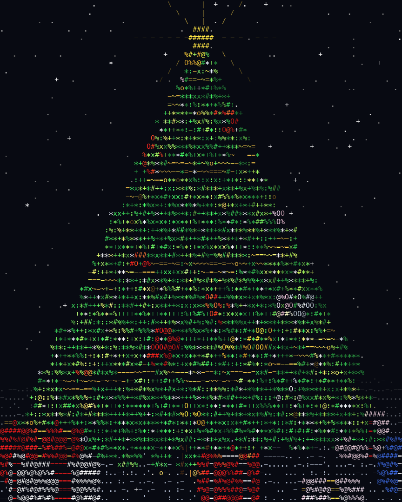

# ASCII Christmas Tree

A rotating 3D Christmas tree rendered as coloured text in your terminal.
One Python file, numpy only.



```bash
pip install numpy
python3 tree.py
```

Ctrl-C quits. Use a tall window (50+ rows) for the full effect.

The scene builds up over ~15 seconds: needles, then the tinsel garland wraps on,
presents appear, ornaments hang, 170 lights switch on one by one, and the star lights up.
Snow falls the whole time.

## Options

| flag | effect |
|------|--------|
| `--music song.mp3` | play your own song (macOS `afplay`) |
| `--mute` | no music (default is a tiny chiptune Jingle Bells) |
| `--check` | render one frame and exit |

## How it works

Everything is a point cloud: branches are drooping whorls, ornaments are small spheres,
presents are box surfaces, the ground is a dotted grid. Each frame rotates the cloud,
lights it (Lambert + ambient occlusion), projects it, and z-sorts it into a character grid
printed with 24-bit ANSI colour.
